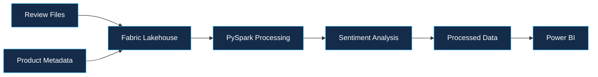
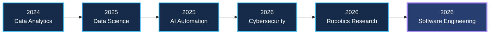
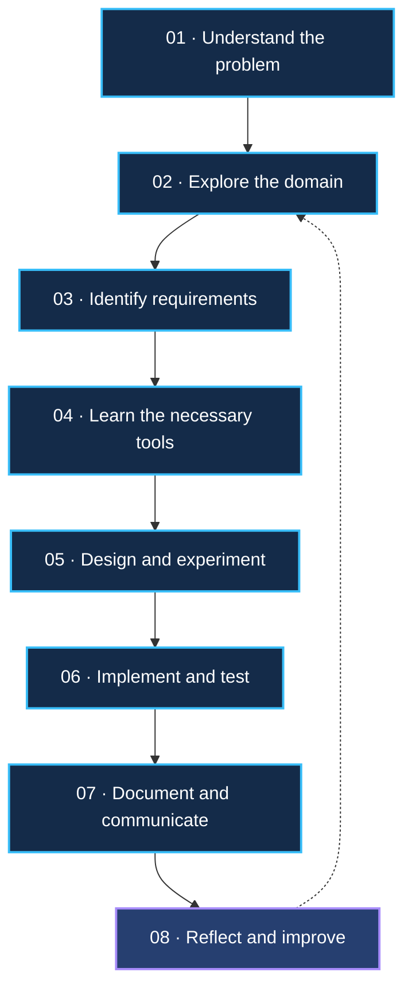

<!-- =========================================================
     DEEPAK KUMAR PATRO | ENGINEERING PORTFOLIO
     VERSION 4.0 — PREMIUM ENGINEERING SHOWCASE
     Repository: github.com/Deepak392/Deepak392
========================================================== -->

<!-- ===================== HERO ===================== -->

 

  

  

CHENNAI, INDIA &nbsp;·&nbsp; SAI UNIVERSITY &nbsp;·&nbsp; COMPUTING & DATA SCIENCE

  

*"Good engineering is not about knowing every tool. It's about understanding the problem well enough to choose the right ones."*

---

<!-- ===================== NAVIGATION ===================== -->

### EXPLORE THE PORTFOLIO

[01 · About](#01--the-person-behind-the-code) &nbsp; / &nbsp;
[02 · Expertise](#02--engineering-domains) &nbsp; / &nbsp;
[03 · Work](#03--selected-work) &nbsp; / &nbsp;
[04 · Journey](#04--the-engineering-timeline)

[05 · Approach](#05--how-i-approach-engineering) &nbsp; / &nbsp;
[06 · Leadership](#06--beyond-engineering) &nbsp; / &nbsp;
[07 · Stack](#07--technology-landscape) &nbsp; / &nbsp;
[08 · GitHub](#08--development-activity) &nbsp; / &nbsp;
[09 · Connect](#09--whats-next)

---

# 01 / THE PERSON BEHIND THE CODE

### A learner by mindset. An engineer in progress.

I'm Deepak, a final-year Computing and Data Science student at **Sai University**, interested in building software systems and exploring the intersection of artificial intelligence, data science, and intelligent technologies.

My experience spans industry internships, robotics research at IIT Bhubaneswar, hackathons, and collaborative software engineering.

I enjoy working on unfamiliar problems, understanding how complex systems fit together, and learning the technologies required to turn ideas into practical solutions.

Rather than limiting myself to one technical domain, I've deliberately explored different areas of computing to develop a broader engineering perspective.

 

| ENGINEERING | COLLABORATION | CONTINUOUS LEARNING |
|:---:|:---:|:---:|
| Building and experimenting | Coordinating and contributing | Exploring unfamiliar domains |
| Systems and problem-solving | Team ownership | Learning through implementation |

> My goal is simple: become an engineer who can understand a problem, learn what is necessary, collaborate effectively, and contribute to building reliable solutions.

---

# 02 / ENGINEERING DOMAINS

### The areas where curiosity meets implementation.

<table>
<tr>
<td width="50%" valign="top">

### 01 · Software Engineering

- Backend development
- REST API design
- Requirements engineering
- System architecture
- Database management
- Agile collaboration

</td>
<td width="50%" valign="top">

### 02 · Artificial Intelligence

- Machine learning
- Computer vision
- NLP and sentiment analysis
- Classification systems
- AI-powered automation
- Predictive analytics

</td>
</tr>
<tr>
<td width="50%" valign="top">

### 03 · Data Engineering

- Data processing
- PySpark
- Microsoft Fabric
- Data pipelines
- Data visualization
- Analytical workflows

</td>
<td width="50%" valign="top">

### 04 · Robotics & Research

- ROS 2
- LiDAR–IMU fusion
- SLAM algorithms
- Point-cloud processing
- Sensor synchronization
- Computer vision

</td>
</tr>
</table>

---

# 03 / SELECTED WORK

### Problems explored. Systems developed. Lessons accumulated.

Selected projects and engineering experiences across different problem domains.

---

<table>
<tr>
<td width="38%" valign="top">

</td>
<td width="62%" valign="top">

### 01 / NEXUS CAREER

**Engineering a university placement ecosystem**

**September–December 2026**

A centralized placement and internship platform designed to connect students, recruiters, and university administrators.

**My role**
- Leading a 19-member engineering team.
- Coordinating frontend, backend, database, QA, DevOps, and security workstreams.
- Contributing to SRS, requirements engineering, and system design.
- Coordinating engineering deliverables and team responsibilities.

**Stack:** React · TypeScript · Django REST · PostgreSQL · Redis · Celery · Docker

[Explore Repository →](https://github.com/Deepak392/nexus-career)

</td>
</tr>
</table>

<strong>Engineering notes — Nexus Career</strong>

**Problem:** Placement workflows require coordination between multiple stakeholders, each with different requirements and responsibilities.

**Engineering challenge:** Translating stakeholder expectations into modular requirements and coordinating implementation across a large engineering team.

**Key learning:** Requirements traceability, architectural thinking, API contracts, task ownership, and collaborative software development.

**Status:** Under development. Proposed features are not necessarily completed functionality.

---

<table>
<tr>
<td width="38%" valign="top">

</td>
<td width="62%" valign="top">

### 02 / LIDAR-INERTIAL SLAM

**Exploring how machines perceive the world**

**June–August 2026**

Explored LiDAR–IMU sensor fusion, SLAM frameworks, and robotics research workflows.

**My contribution**
- Worked with ROS 2 development environments.
- Explored FAST-LIO2, LIO-SAM, KISS-ICP, LOAM, and Point-LIO.
- Worked on NCLT dataset preparation and ROS 2 bag conversion.
- Investigated sensor synchronization and point-cloud reconstruction.
- Collected synchronized LiDAR–IMU data using a custom sensing platform.
- Developed a plant-root phenotyping pipeline involving ResNet34 segmentation, skeletonization, and graph-based analysis.

**Stack:** ROS 2 · C++ · FAST-LIO2 · LIO-SAM · PCL · Eigen · GTSAM · ResNet34

</td>
</tr>
</table>

<strong>Engineering notes — Robotics research</strong>

**Problem:** Autonomous systems require reliable spatial understanding using sensor measurements collected over time.

**Engineering challenge:** Understanding unfamiliar frameworks, sensor data, timestamp alignment, dependencies, and point-cloud processing.

**Key learning:** Research-oriented problem-solving, robotics software workflows, sensor fusion, and systematic debugging.

---

<table>
<tr>
<td width="38%" valign="top">

</td>
<td width="62%" valign="top">

### 03 / PHISHGUARD

**Making URL safety more informative**

**February 2026**

A URL safety analyzer exploring multi-signal phishing detection.

**Solution components**
- Heuristic URL pattern checks.
- Machine-learning classification.
- WHOIS, SSL, and DNS validation.
- Threat-intelligence API integrations where configured.
- Risk categorization and analysis.

**Stack:** React · FastAPI · SQLite · Python · Machine Learning

[Explore Repository →](https://github.com/Deepak392/URL-Safety-Analyzer)

</td>
</tr>
</table>

<strong>Engineering notes — PhishGuard</strong>

**Problem:** Blacklist-only detection can miss contextual information about suspicious URLs.

**Engineering challenge:** Combining multiple signals into an understandable risk assessment.

**Key learning:** API integration, rapid prototyping, collaborative development, and technical risk communication.

---

<table>
<tr>
<td width="38%" valign="top">

</td>
<td width="62%" valign="top">

### 04 / AI COMPETITOR WATCHDOG

**Turning competitive intelligence into actionable information**

**Signeasy · December 2025–January 2026**

A V1 prototype exploring automated competitor monitoring and AI-generated summaries.

**My contribution**
- Explored competitor website and news monitoring.
- Investigated meaningful-change detection.
- Worked on structured AI summarization workflows.
- Explored Slack-based information delivery.
- Considered the requirements of Product, Marketing, Sales, and Leadership teams.

**Focus:** AI Automation · Competitive Intelligence · AI Summarization · Slack

[Explore Repository →](https://github.com/Deepak392/ai-competitor-watchdog-v1)

</td>
</tr>
</table>

<strong>Engineering notes — Competitor Watchdog</strong>

**Problem:** Manually tracking competitor activity can be inconsistent and time-consuming.

**Engineering challenge:** Making information collection useful while avoiding excessive notifications and irrelevant summaries.

**Key learning:** Stakeholder understanding, information workflows, business context, and automation design.

---

<table>
<tr>
<td width="38%" valign="top">

</td>
<td width="62%" valign="top">

### 05 / AI E-COMMERCE FEEDBACK ENGINE

**Connecting data engineering with customer intelligence**

**4i Apps Solutions · June–July 2025**

Explored customer-review processing and sentiment analysis using Microsoft Fabric.

**My contribution**
- Data ingestion into Microsoft Fabric Lakehouse.
- Review and metadata processing using PySpark.
- Sentiment analysis with TextBlob.
- Processed data preparation for reporting.
- Power BI reporting concepts.

**Stack:** Microsoft Fabric · PySpark · TextBlob · Power BI

</td>
</tr>
</table>

<strong>Engineering notes — Data pipeline</strong>

**Key learning:** Data ingestion, transformation, distributed processing, and analytical reporting.

This represents architecture and prototyping experience, not a claim of production deployment.

---

<table>
<tr>
<td width="38%" valign="top">

</td>
<td width="62%" valign="top">

### 06 / RETENTION & CHURN ANALYSIS

**Exploring the signals behind customer attrition**

**Signeasy · August 2024**

Worked with the Analytics team to investigate customer retention and churn patterns.

**My contribution**
- Explored retained and churned customer accounts.
- Investigated usage patterns and customer personas.
- Examined potential indicators of churn.
- Built an exploratory retention-versus-churn model.
- Shared intermediate findings during team discussions.

**Focus:** Python · Data Analysis · EDA · Predictive Modeling

</td>
</tr>
</table>

<strong>Engineering notes — Customer analytics</strong>

**Problem:** Understanding patterns that might distinguish retained customers from churned customers.

**Engineering challenge:** Exploring available data while avoiding unsupported conclusions about predictive performance.

**Key learning:** Business-oriented data analysis, exploratory modelling, and communicating analytical findings.

---

[EXPLORE ALL MY REPOSITORIES →](https://github.com/Deepak392?tab=repositories)

---

# 04 / THE ENGINEERING TIMELINE

### From data analytics to multidisciplinary engineering.

*An evolving journey across problem domains, technologies, and responsibilities.*

| Period | Experience | Engineering focus |
|:---|:---|:---|
| Aug 2024 | Signeasy — Data Analytics | Business intelligence and customer analytics |
| Jun–Jul 2025 | 4i Apps — Data Science | Data pipelines and sentiment analysis |
| Dec 2025–Jan 2026 | Signeasy — Founder's Office | AI automation and competitive intelligence |
| Feb 2026 | PhishGuard — Hackathon | Cybersecurity and rapid development |
| Jun–Aug 2026 | IIT Bhubaneswar — Research | Robotics and sensor fusion |
| Sep–Dec 2026 | Nexus Career — Team Lead | Software engineering and team coordination |

---

# 05 / HOW I APPROACH ENGINEERING

### A problem-first approach to building things.

I believe the most valuable engineering skill is the ability to approach unfamiliar problems systematically.

My preferred learning and development cycle:

### Engineering principles

<table>
<tr>
<td width="50%" valign="top">

**01 · Curiosity**

Exploring unfamiliar technical domains and understanding the fundamentals before implementation.

**02 · Ownership**

Taking responsibility for assigned work, communicating progress, and following through on deliverables.

**03 · Structured learning**

Breaking down complex concepts into manageable problems and learning through implementation.

</td>
<td width="50%" valign="top">

**04 · Collaboration**

Working with different people, respecting ownership, and understanding multiple perspectives.

**05 · Critical thinking**

Investigating failures, understanding trade-offs, and avoiding assumptions.

**06 · Engineering integrity**

Distinguishing between implemented functionality, prototypes, experiments, and proposed ideas.

</td>
</tr>
</table>

---

# 06 / BEYOND ENGINEERING

### Building with people, not just technology.

My university experience has also involved leadership, financial responsibility, event coordination, and student community initiatives.

<table>
<tr>
<td width="50%" valign="top">

### STUDENT GOVERNMENT

**Treasurer · Sai University**

- Budgeting and financial coordination.
- Vendor negotiations and reimbursements.
- Student event planning.
- Website and social media initiatives.

</td>
<td width="50%" valign="top">

### TURINGITES

**Core Member · Computer Science Society**

- Technical community participation.
- Collaborative learning.
- Student engagement and initiatives.

</td>
</tr>
<tr>
<td width="50%" valign="top">

### NEXUS CAREER

**Engineering Team Lead**

- Coordinating a 19-member team.
- Cross-functional communication.
- Task ownership and deliverable tracking.

</td>
<td width="50%" valign="top">

### UNIVERSITY INITIATIVES

**Events & Hackathons**

- SRUSHTI '25 hackathon.
- University workshops.
- Student events and activities.
- Collaborative campus initiatives.

</td>
</tr>
</table>

---

# 07 / TECHNOLOGY LANDSCAPE

### Tools I've explored across projects, internships, and research.

#### Programming Languages

#### AI / ML / Data Science

 

#### Backend & Databases

#### DevOps & Development

#### Robotics & Research

 

Technology exposure varies by project. The list reflects tools explored or used, not an assertion of expert-level proficiency in every technology.

---

# 08 / DEVELOPMENT ACTIVITY

### Beyond the contribution graph. Explore the actual work.

  

  

### WHAT YOU'LL FIND IN MY REPOSITORIES

<table>
<tr>
<td align="center" width="33%">

**SOFTWARE**

Applications, APIs, and collaborative development

</td>
<td align="center" width="33%">

**INTELLIGENCE**

ML experiments, data processing, and automation

</td>
<td align="center" width="33%">

**RESEARCH**

Robotics, experimentation, and technical exploration

</td>
</tr>
</table>

 

**I want my repositories to tell the story of what I've learned, how I've approached problems, and how my engineering skills continue to evolve.**

---

# 09 / WHAT'S NEXT?

### The next chapter is about building better systems.

I'm currently focused on strengthening my software engineering fundamentals while continuing to explore intelligent systems.

My areas of interest include:

- Backend engineering and scalable system design.
- Production-oriented AI/ML applications.
- Data engineering and distributed processing.
- MLOps, cloud infrastructure, and deployment.
- Software architecture and engineering best practices.

I'm looking forward to opportunities where I can contribute to real engineering challenges, learn from experienced teams, and progressively take on greater responsibilities.

 

### OPEN TO LEARNING. READY TO CONTRIBUTE.

**Let's build something meaningful.**

 

  

Designed with curiosity. Built with code. Continuously evolving.

 

**DEEPAK KUMAR PATRO**

Chennai, India · Computing & Data Science · Class of 2027

 

<!-- ================= END OF README ================= --> 
