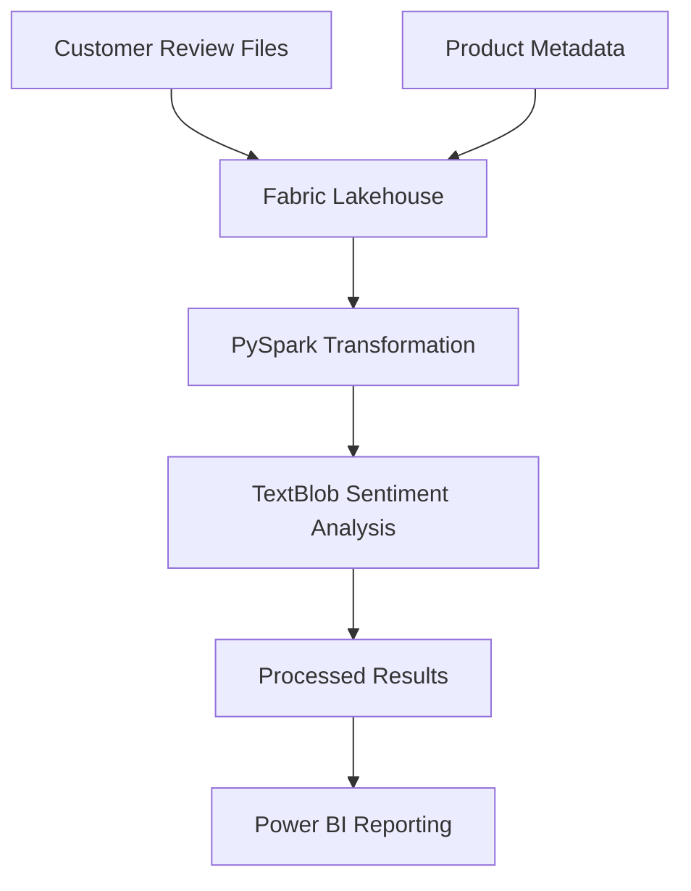
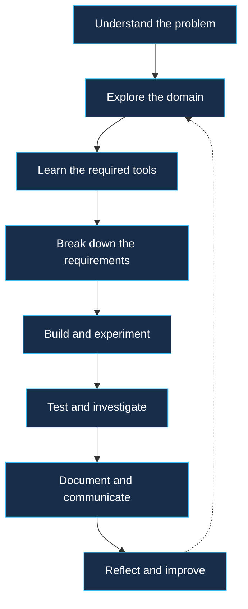

<!-- =======================================================
     DEEPAK KUMAR PATRO | ENGINEERING PORTFOLIO
     Special GitHub Profile Repository: Deepak392
======================================================== -->

<!-- HERO -->

<div align="center">


<br/>

### Computing & Data Science Undergraduate


<br/>

<a href="YOUR_LINKEDIN_URL">

</a>
<a href="mailto:YOUR_EMAIL">

</a>
<a href="https://github.com/Deepak392">

</a>

<br/><br/>

*"The interesting part of engineering isn't knowing every tool. It's figuring out what to do when you encounter something you don't know."*

</div>

---

<div align="center">

`CHENNAI, INDIA` &nbsp;·&nbsp; `SAI UNIVERSITY` &nbsp;·&nbsp; `CLASS OF 2027`

</div>

# 01 / THE ENGINEER

I'm Deepak, a final-year Computing and Data Science student at **Sai University**, interested in the intersection of software engineering, artificial intelligence, data science, and intelligent systems.

My journey has taken me through industry internships, robotics research at IIT Bhubaneswar, hackathons, and collaborative software engineering.

I enjoy working on unfamiliar problems, understanding how different components fit together, and learning the technologies needed to turn an idea into a practical solution.

### My engineering footprint

<table>
<tr>
<td align="center" width="33%">
<h2>19</h2>
<strong>Team Members</strong><br/>
<sub>Engineering team leadership</sub>
</td>
<td align="center" width="33%">
<h2>6</h2>
<strong>Featured Projects</strong><br/>
<sub>Across different problem domains</sub>
</td>
<td align="center" width="33%">
<h2>4+</h2>
<strong>Problem Domains</strong><br/>
<sub>Software, AI, data & robotics</sub>
</td>
</tr>
</table>

<sub>Figures represent the featured work documented in this portfolio, not production deployments or independently measured outcomes.</sub>

---

# 02 / THE ENGINEERING MAP

*Different domains. Different constraints. One continuous learning journey.*

<div align="center">


</div>

| Domain | What I've explored |
|:---|:---|
| Software Engineering | System design, backend development, REST APIs, team coordination |
| AI / ML | Classification, sentiment analysis, computer vision, NLP |
| Data Engineering | Data pipelines, PySpark, Microsoft Fabric, analytical workflows |
| Robotics | LiDAR–IMU fusion, SLAM, point-cloud processing, ROS 2 |
| Cybersecurity | URL risk analysis, phishing detection, threat-intelligence integrations |

---

# 03 / SELECTED ENGINEERING WORK

<sub>A collection of problems I've explored, systems I've contributed to, and engineering lessons I've gained.</sub>

<br/>

## 01 — NEXUS CAREER

### Engineering a university placement ecosystem


**Sai University · September–December 2026**

A centralized placement and internship platform designed to connect students, recruiters, alumni, and university administrators.

**My contribution**
- Leading a 19-member engineering team across frontend, backend, database, infrastructure, UI/UX, QA, and security.
- Contributing to requirements engineering, SRS, UML, and system design.
- Coordinating modular ownership and engineering deliverables.
- Working on REST API design, documentation, and security considerations.
- Following Agile/Scrum practices to translate requirements into manageable tasks.

**Technology stack**

`React` `TypeScript` `Django REST` `PostgreSQL` `Redis` `Celery` `Docker`

<details>
<summary><strong>↳ Explore the engineering perspective</strong></summary>

**The problem:** Placement-related information and workflows need a centralized system for students, recruiters, and university administrators.

**The engineering challenge:** Translating multiple stakeholder requirements into modular components while coordinating a large team.

**What I'm learning:** Requirements traceability, ownership boundaries, API contracts, security considerations, and the importance of keeping implementation aligned with architecture.

**Project status:** Under development. Proposed features and intended outcomes should not be interpreted as completed functionality.

</details>

<div align="right">

[View Project Repository →](https://github.com/Deepak392/nexus-career)

</div>

---

## 02 — LIDAR-INERTIAL SLAM

### Understanding how machines perceive the world


**IIT Bhubaneswar · June–August 2026**

Explored LiDAR–IMU sensor fusion and simultaneous localization and mapping (SLAM) for autonomous navigation.

**My contribution**
- Set up ROS 2 development environments.
- Explored FAST-LIO2, LIO-SAM, KISS-ICP, LOAM, and Point-LIO.
- Worked on NCLT benchmark dataset preparation and ROS 2 bag conversion.
- Investigated timestamped point-cloud reconstruction and sensor synchronization.
- Collected synchronized LiDAR–IMU data using a custom sensing platform.
- Developed a plant-root phenotyping pipeline using ResNet34 segmentation, skeletonization, and graph-based analysis.

**Technology stack**

`ROS 2` `C++` `FAST-LIO2` `LIO-SAM` `PCL` `Eigen` `GTSAM` `RViz` `ResNet34`

<details>
<summary><strong>↳ Explore the engineering perspective</strong></summary>

**The problem:** Autonomous systems need reliable spatial understanding using noisy, time-dependent sensor measurements.

**The engineering challenge:** Working with sensor data, synchronization, framework configurations, dependencies, and point-cloud processing.

**What I'm learning:** Robotics software workflows, sensor fusion, dataset preparation, and systematic debugging in research environments.

</details>

---

## 03 — PHISHGUARD

### Making URL safety more informative


**Sai University · February 2026**

A URL safety analyzer exploring a multi-signal approach to phishing detection instead of relying exclusively on blacklist-based warnings.

**Solution components**
- Heuristic URL pattern checks.
- Machine-learning classification.
- WHOIS, SSL, and DNS validation.
- Threat-intelligence integrations such as VirusTotal and Google Safe Browsing where configured.
- A risk-scoring workflow with Safe, Suspicious, and Phishing categories.

**Technology stack**

`React` `FastAPI` `SQLite` `Machine Learning` `Security APIs`

<details>
<summary><strong>↳ Explore the engineering perspective</strong></summary>

**The problem:** A blacklist-only approach cannot provide comprehensive contextual information about every suspicious URL.

**The engineering challenge:** Combining different risk signals into a structured assessment that can be understood by end users.

**What I'm learning:** Collaborative problem-solving, rapid feature prioritization, API integration, and communicating technical risk.

The broader design also considered scan history, bulk URL analysis, analytics, and a browser extension. These should not be assumed to be fully implemented.

</details>

<div align="right">

[View Project Repository →](https://github.com/Deepak392/URL-Safety-Analyzer)

</div>

---

## 04 — AI COMPETITOR WATCHDOG

### Turning competitive intelligence into actionable information


**Signeasy · Founder's Office Internship · December 2025–January 2026**

A focused V1 prototype intended to automate competitor monitoring and deliver meaningful updates to internal stakeholders.

**My contribution**
- Explored monitoring of competitor websites, news, and app-store listings.
- Focused on identifying meaningful changes rather than generating excessive notifications.
- Worked on an end-to-end workflow for collecting updates and producing structured AI summaries.
- Explored Slack-based information delivery.
- Considered the needs of Product, Marketing, Sales, and Leadership teams.

**Technology focus**

`AI Automation` `Competitive Intelligence` `AI Summarization` `Slack`

<details>
<summary><strong>↳ Explore the engineering perspective</strong></summary>

**The problem:** Manually tracking competitor activity can be inconsistent and time-consuming.

**The engineering challenge:** Making information collection and summarization useful, understandable, and low-noise.

**What I'm learning:** Understanding stakeholder needs, designing information workflows, and prioritizing business relevance over unnecessary technical complexity.

</details>

<div align="right">

[View Project Repository →](https://github.com/Deepak392/ai-competitor-watchdog-v1)

</div>

---

## 05 — AI E-COMMERCE FEEDBACK ENGINE

### Connecting data engineering with customer intelligence


**4i Apps Solutions · Data Science & ML Internship · June–July 2025**

An architecture and prototype exploring how customer reviews could be processed and analyzed using Microsoft Fabric.

**My contribution**
- Explored data ingestion into a Microsoft Fabric Lakehouse.
- Joined review and metadata datasets using PySpark.
- Applied TextBlob sentiment analysis.
- Explored processed data storage for reporting.
- Designed Power BI reporting concepts to visualize product sentiment.

**Technology stack**

`Microsoft Fabric` `Lakehouse` `PySpark` `TextBlob` `Power BI`

<details>
<summary><strong>↳ Explore the data workflow</strong></summary>



**The engineering challenge:** Connecting ingestion, transformation, sentiment analysis, and reporting into one coherent workflow.

**What I'm learning:** Data pipeline design, distributed data processing, and the relationship between technical outputs and business intelligence.

This was architecture and prototyping work, not a claim of production deployment.

</details>

---

## 06 — RETENTION & CHURN ANALYSIS

### Exploring the signals behind customer attrition


**Signeasy · Data Analyst Internship · August 2024**

Worked with the Analytics team to investigate customer retention and churn patterns following an earlier business review that identified approximately $1 million in annual recurring revenue loss on the web application.

**My contribution**
- Explored retained and churned customer accounts.
- Investigated product usage patterns and customer personas.
- Examined potential early indicators of churn.
- Built an exploratory retention-versus-churn model.
- Shared intermediate findings during regular team discussions.

**Technology focus**

`Python` `Data Analysis` `EDA` `Predictive Modeling`

<details>
<summary><strong>↳ Explore the engineering perspective</strong></summary>

**The problem:** Understanding which patterns might distinguish retained customers from churned customers.

**The analytical challenge:** Investigating relationships in available data without overstating the predictive reliability of an exploratory model.

**What I'm learning:** Business-oriented data exploration, communicating findings, and understanding the limitations of analytical models.

</details>

---

# 04 / THE ENGINEERING JOURNEY

*An evolution across problem domains, technologies, and responsibilities.*

```mermaid
flowchart LR
    A["2024<br/>Data Analytics"] --> B["2025<br/>Data Science"]
    B --> C["2025<br/>AI Automation"]
    C --> D["2026<br/>Cybersecurity"]
    D --> E["2026<br/>Robotics Research"]
    E --> F["2026<br/>Software Engineering"]
    
    classDef start fill:#172D4A,stroke:#38BDF8,color:#fff
    classDef end fill:#263F70,stroke:#A78BFA,color:#fff
    
    class A,B,C,D,E start
    class F end
```

| Period | Experience | Key learning |
|:---|:---|:---|
| Aug 2024 | Signeasy — Data Analytics | Understanding business data |
| Jun–Jul 2025 | 4i Apps — Data Science | Data pipelines and sentiment analysis |
| Dec 2025–Jan 2026 | Signeasy — Founder's Office | AI workflows and business context |
| Feb 2026 | PhishGuard — Hackathon | Rapid collaborative development |
| Jun–Aug 2026 | IIT Bhubaneswar — Research | Robotics and sensor fusion |
| Sep–Dec 2026 | Nexus Career — Team Lead | Software engineering and coordination |

---

# 05 / HOW I THINK ABOUT ENGINEERING

### My development philosophy

I don't believe a project is just a collection of technologies. Every meaningful project involves decisions, constraints, trade-offs, debugging, and collaboration.

Here's the approach I try to follow:



| Principle | How I put it into practice |
|:---|:---|
| Curiosity | Explore unfamiliar technical domains instead of avoiding them. |
| Structured learning | Break down complex problems into manageable tasks. |
| Ownership | Take responsibility for assigned work and communicate progress. |
| Collaboration | Coordinate with teammates and learn from different perspectives. |
| Critical thinking | Investigate why something fails before attempting random fixes. |
| Engineering integrity | Clearly distinguish working implementations from prototypes and proposed features. |

---

# 06 / BEYOND THE TERMINAL

*Engineering is also about people, responsibility, and execution.*

**Student Government — Treasurer**

Elected to manage financial coordination, budgeting, vendor negotiations, and reimbursements. Also contributed to student initiatives and university events.

**Turingites — Computer Science Society**

Core member contributing to the university's technical community.

**Team Leadership — Nexus Career**

Leading a 19-member engineering team, coordinating work across different technical and non-technical responsibilities.

**University Initiatives**

Contributed to hackathons, workshops, student events, and collaborative campus initiatives.

---

# 07 / MY TECH STACK

<div align="center">

### Languages


### AI / ML / Data Science


### Backend / Databases


### Robotics / Research


### Development Tools


</div>

<sub>My technology landscape reflects practical exposure across projects, internships, and research. Familiarity does not imply production-level expertise in every listed tool.</sub>

---

# 08 / GITHUB ACTIVITY

<div align="center">

<a href="https://github.com/Deepak392">

</a>

<a href="https://github.com/Deepak392">

</a>

<br/><br/>


</div>

---

# 09 / WHAT'S NEXT?

I'm currently focused on becoming a stronger software engineer while continuing to explore intelligent systems.

Areas I'm particularly interested in:

- Backend engineering and scalable system design.
- Production-ready AI/ML applications.
- Data engineering and distributed processing.
- MLOps, deployment, and cloud infrastructure.
- Software architecture and engineering best practices.

I'm interested in opportunities where I can contribute to real engineering challenges, learn from experienced teams, and progressively take on greater responsibility.

---

<div align="center">


### LET'S BUILD SOMETHING MEANINGFUL.

**Curiosity starts the journey. Engineering takes it forward.**

<a href="YOUR_LINKEDIN_URL">

</a>

<br/><br/>

<sub>Designed with curiosity, built with code, and continuously evolving.</sub>

**Deepak Kumar Patro** · Chennai, India

</div>
